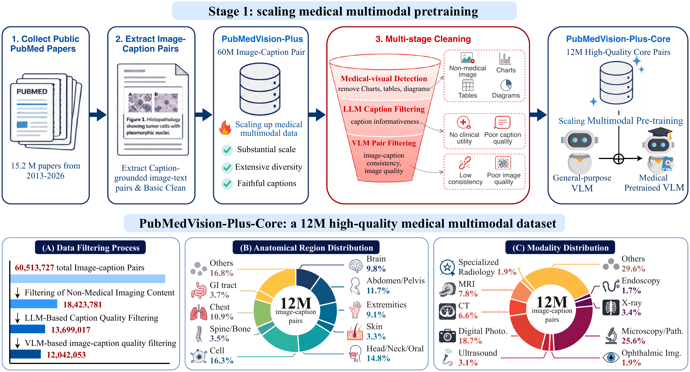
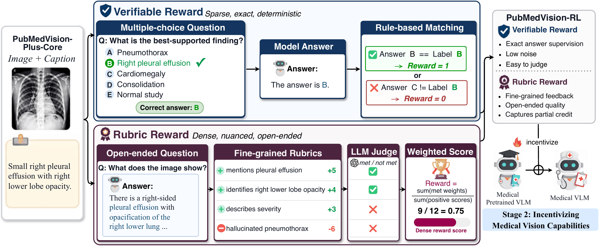

# Incentivizing Medical Vision Capabilities from Large-Scale Multimodal Pre-training

<div align="center">
<h3>HuatuoGPT-Vision-2</h3>
</div>

<p align="center">
📃 <a href="https://openreview.net/pdf?id=0BXKsjKlFJ" target="_blank">Paper</a> ｜
📚 <a href="https://huggingface.co/datasets/FreedomIntelligence/PubMedVision-Plus" target="_blank">PubMedVision-Plus</a>
</p>

## ⚡ Introduction

Welcome to **HuatuoGPT-Vision-2**, the second generation of our medical vision-language model (VLM) series!

HuatuoGPT-Vision-2 is built on a simple recipe: **scale medical multimodal pre-training, then elicit medical vision capabilities directly with reinforcement learning (RL)**.

- **Stage 1: Scaling medical multimodal pre-training.** We build **PubMedVision-Plus**, the largest open medical image-text corpus with **60M** image-caption pairs from 15.2M PubMed papers, and filter it into a **12M** high-quality subset for pre-training.

<p align="center"></p>

- **Stage 2: Incentivizing medical vision capabilities.** We find that SFT struggles to elicit pre-trained medical visual knowledge. Instead, we synthesize **PubMedVision-RL** from the pre-training captions, with verifiable and rubric-based questions, and train with RL.

<p align="center"></p>

HuatuoGPT-Vision-2 improves its Qwen3-VL backbones by about **10 points** on medical benchmarks. The 32B model outperforms open-source and medical VLMs of similar size.

## 👨‍⚕️ Model

| Model | Backbone | Access |
| --- | --- | --- |
| **HuatuoGPT-Vision-2-8B** | Qwen3-VL-8B-Instruct | Coming soon |
| **HuatuoGPT-Vision-2-32B** | Qwen3-VL-32B-Instruct | Coming soon |

**HuatuoGPT-Vision-2** can be used like [Qwen3-VL](https://huggingface.co/Qwen/Qwen3-VL-8B-Instruct) and deployed with [vLLM](https://github.com/vllm-project/vllm) or [SGLang](https://github.com/sgl-project/sglang).

## 📚 Data

| Dataset | Size | Description | Access |
| --- | ---: | --- | --- |
| **PubMedVision-Plus** | 12M | High-quality medical image-caption pairs from PubMed for pre-training | [Hugging Face](https://huggingface.co/datasets/FreedomIntelligence/PubMedVision-Plus) |
| **PubMedVision-RL** | 70K | Verifiable and rubric-based RL questions synthesized from PubMedVision-Plus | Coming soon |
| **MedMM-ExpertRubric** | 500 | Open-ended medical VQA benchmark with physician-verified rubrics | Coming soon |

## 🚀 Training

Coming soon.

## ⚠️ Disclaimer

HuatuoGPT-Vision-2 is intended for academic research only. It must not be used for diagnosis, treatment, triage, or other medical decisions.

## 🩺 HuatuoGPT Series

Explore our HuatuoGPT series:

- [**HuatuoGPT**](https://github.com/FreedomIntelligence/HuatuoGPT): Taming Language Models to Be a Doctor
- [**HuatuoGPT-II**](https://github.com/FreedomIntelligence/HuatuoGPT-II): One-stage Training for Medical Adaptation of LLMs
- [**HuatuoGPT-Vision**](https://github.com/FreedomIntelligence/HuatuoGPT-Vision): Injecting Medical Visual Knowledge into Multimodal LLMs at Scale
- [**HuatuoGPT-o1**](https://github.com/FreedomIntelligence/HuatuoGPT-o1): Towards Medical Complex Reasoning with LLMs
- [**HuatuoGPT-3**](https://github.com/FreedomIntelligence/HuatuoGPT-3): OnePO: Direct One-stage Policy Optimization for SFT-free Domain Adaptation
- [**HuatuoGPT-Vision-2**](https://github.com/FreedomIntelligence/HuatuoGPT-Vision-2): Incentivizing Medical Vision Capabilities from Large-Scale Multimodal Pre-training

## 📖 Citation

```bibtex
@inproceedings{chen2026incentivizing,
  title={Incentivizing Medical Vision Capabilities from Large-Scale Multimodal Pre-training},
  author={Chen, Junying and Cai, Zhenyang and Yang, Yunjin and Cai, Kunyuan and Wang, Rongsheng and Wang, Xidong and Yu, Geyang and Feng, Xiangyi and Wang, Benyou},
  booktitle={The Fortieth Annual Conference on Neural Information Processing Systems},
  year={2026},
  url={https://openreview.net/forum?id=0BXKsjKlFJ}
}
```
